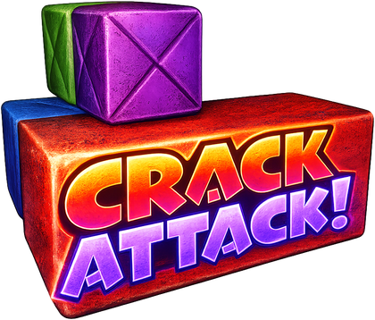
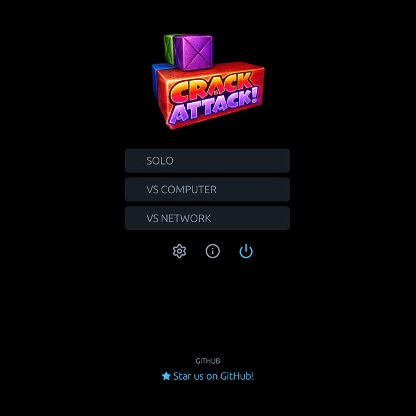
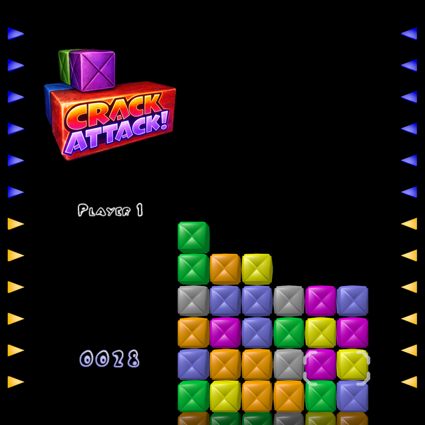
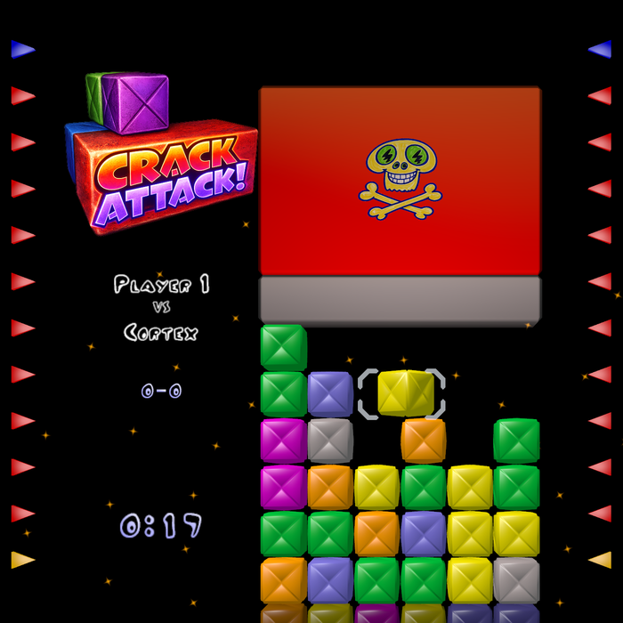

<p align="center">
  
</p>

<h1 align="center">Crack Attack! — Back From The Stack</h1>

<p align="center">
  <b>Swap blocks, chain clears, bury your opponent under garbage.</b><br>
  The classic puzzle game, rewritten in Rust, with music that follows the pressure on your stack.
</p>

<p align="center">
  <a href="../../releases/latest"></a>
  
  <a href="LICENSE"></a>
</p>

<p align="center">
  
  
  
</p>

A fast puzzle game: swap blocks, line up three or more of the same color, chain clears
together and bury your opponent under garbage. This is a Rust rewrite of
[Crack Attack!](https://github.com/gnu-lorien/crack-attack) (Daniel R. Nelson, 2000–2006), with a
WebGPU renderer and SDL3. During a game, the music adapts to the pressure on your stack.

- **Three ways to play**: solo, versus the computer (three difficulty levels) and versus
  another player on your local network (automatic discovery or manual address), with a
  network ranking.
- **Keyboard and gamepad**: fully navigable menus, rebindable controls.
- **Eleven languages**: English, French, German, Spanish, Italian, Polish, Russian, Turkish,
  Simplified Chinese, Japanese and Korean (all but English and French are new in this beta:
  corrections are welcome).

## Download

Ready-to-run packages for Windows, macOS and Linux are on the
[Releases](../../releases) page, each as an installer and as a plain archive (unpack it
anywhere and run it). Both contain the game and all its data.

- **Windows** — `crackattack-<version>-windows-x86_64-setup.exe` installs the game for your user
  (no administrator rights), with a Start menu entry and an uninstaller; or unpack
  `crackattack-<version>-windows-x86_64.zip` and run `crackattack.exe`. Requires a graphics card
  and driver that support DirectX 12 or Vulkan. Windows SmartScreen may warn the first time,
  as the program is not signed: click **More info**, then **Run anyway**.
- **macOS** — `crackattack-<version>-macos-arm64.dmg`: open it and drag *Crack Attack* into
  *Applications* (or unpack the `.zip`), or install it with [Homebrew](https://brew.sh):
  `brew install --cask thiosaur/tap/crackattack`. Apple Silicon, macOS 11 or later. The
  application is not signed by Apple, so macOS blocks it the first time:
  - macOS 15 or later: open *Crack Attack.app* once, then go to *System Settings → Privacy &
    Security* and click **Open Anyway**;
  - macOS 14 or earlier: right-click (or Control-click) *Crack Attack.app*, choose **Open**, then
    confirm;
  - or, from a terminal (adjust the path if the app is elsewhere):
    `xattr -dr com.apple.quarantine "/Applications/Crack Attack.app"`

  Afterwards it opens normally.
- **Linux** — `crackattack-<version>-linux-x86_64.AppImage`: make it executable
  (`chmod +x`, or in the file properties) and run it; or unpack
  `crackattack-<version>-linux-x86_64.tar.gz` and run `./crackattack`. Uses the usual desktop
  libraries (ALSA, X11 or Wayland) already present on most distributions.

To update, just download the new package: your settings, scores and network ranking live in
your user folder, not in the package (see [Your data](#your-data)).

## How to play

- Move the cursor with the **arrow keys** (gamepad: D-pad or left stick).
- Swap the two blocks under the cursor with **Space** (gamepad: bottom face button, A / Cross).
- Line up **3 or more blocks** of the same color, horizontally or vertically, to clear them.
- Clears that cascade make **chains**; several lines at once make **combos**. Both send
  garbage to your opponent.
- Hold **Enter** (gamepad: left face button, X / Square) to raise the stack faster.
- If the stack reaches the top, you lose.

**P** (gamepad: Start) pauses, **Escape** goes back, **F12** saves a screenshot. All
gameplay controls can be changed in *Options → Keyboard* and *Options → Gamepad*.

## Network play

*VS Network* finds other players on the same local network automatically (mDNS) and lets you
invite them; you can also connect to an address directly. The game listens on TCP port 45678
(or the next free one): allow it in your firewall if invitations do not arrive. Both players
need compatible versions; the game tells you if they are not.

## Update check

Packages downloaded from the Releases page check **once a day** whether a newer version has
been published. The check is a single HTTPS request to the GitHub API
(`api.github.com/repos/…/releases/latest`) sent with the user agent
`crackattack/<version>`; only the version number in the reply is used. Nothing is ever
downloaded or installed: when a newer version exists, a line in the menu links to the
download page.

- *About → Updates* (the ⓘ entry of the main menu) shows the installed version and the result
  of the last check; *Check now* checks on demand, and unticking *Check for updates* turns the
  daily check off.
- Builds from source, and packages made by distributions or stores, do not check at all.

## Your data

Settings, scores and controls are stored in `state.json`, the network ranking in
`ladder.json`, and the log of the last two sessions in `crackattack.log` (send it when you
report a problem). They are in:

| System | Folder |
|---|---|
| Linux | `~/.config/crack-attack/` |
| macOS | `~/Library/Application Support/crack-attack/` |
| Windows | `%APPDATA%\crack-attack\` |

## Building from source

Requirements: **Rust** through [rustup](https://rustup.rs) (it installs the compiler version
pinned in `rust-toolchain.toml`; the minimum supported version is 1.85), **CMake** and a **C
compiler** (SDL3 is built from source and linked statically).

- **macOS** — Xcode Command Line Tools (`xcode-select --install`) and CMake
  (`brew install cmake`).
- **Windows** — Visual Studio Build Tools (MSVC) and CMake.
- **Linux (Debian/Ubuntu)** —
  `sudo apt install cmake build-essential pkg-config libasound2-dev libx11-dev libxext-dev libxrandr-dev libxcursor-dev libxfixes-dev libxi-dev libxss-dev libxtst-dev libxkbcommon-dev libwayland-dev wayland-protocols libdecor-0-dev libegl1-mesa-dev libgles2-mesa-dev libdrm-dev libgbm-dev libdbus-1-dev libudev-dev`

```sh
cargo run --release -p crackattack-webgpu
```

Run it from the repository root (or next to an `assets/` folder) so that the game finds its
data. `cargo test --workspace` runs the test suite. To build without the update check:
`cargo build --release -p crackattack-webgpu --no-default-features --features native`.

The workspace also contains `crackattack-terminal`, a text renderer that plays in a
terminal (`cargo run -p crackattack-terminal`).

## Feedback

Found a bug? Open an [issue](../../issues). Feedback, questions, ideas or memories of the
original game are welcome in [Discussions](../../discussions).

## Credits

- The original **Crack Attack!** (2000–2006): created by **Daniel R. Nelson**
  ([@AluminumAngel](https://github.com/AluminumAngel)); developed and maintained by
  **R. Andrew Sayman** ([@gnu-lorien](https://github.com/gnu-lorien)), with **Kevin Webb**.
  Its C++ source code is at [gnu-lorien/crack-attack](https://github.com/gnu-lorien/crack-attack).
  The full list of copyright holders is in [AUTHORS](AUTHORS).
- **This edition** — Back From The Stack: Rust / WebGPU rewrite (2.x) by Thiosaur.
- Images, sound effects, music and fonts: origin and license of every file in
  [crackattack-webgpu/assets/CREDITS.md](crackattack-webgpu/assets/CREDITS.md). The music is
  based on "Les Crapauds" (Victor Meusy, 1897, public domain).
- Libraries: wgpu, SDL3, egui, rodio and the other crates listed in `Cargo.lock`. Their
  licenses are collected in `THIRD-PARTY-LICENSES.html`, shipped with every release.

## License

Crack Attack! is free software: you can redistribute it and/or modify it under the terms of
the GNU General Public License as published by the Free Software Foundation, either
**version 3 of the License, or (at your option) any later version**. See [LICENSE](LICENSE).

The original Crack Attack! 1.1.14 is licensed under the GPL version 2 or later, which allows
this derivative work to use version 3. The source code of each release is the tagged commit
of this repository, with its `Cargo.lock`.
